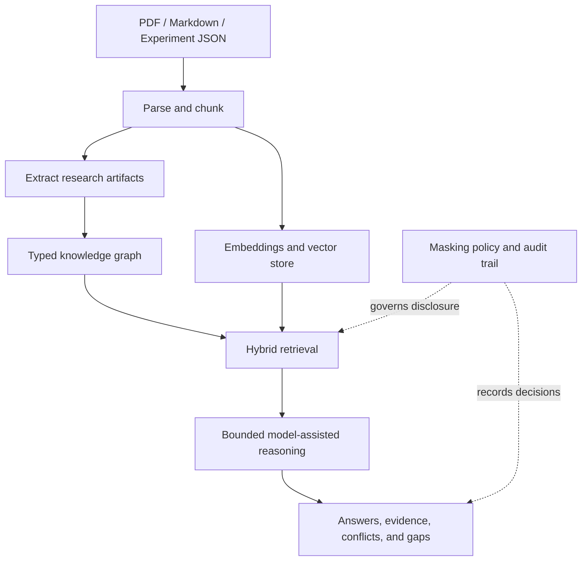

# VICTOR

**A local-first research-intelligence system for building a traceable, evolving body of evidence.**

Victor combines document ingestion, a typed knowledge graph, vector retrieval, model-assisted reasoning, and controllable memory disclosure. It is designed to help researchers connect what has been measured, experimentally observed, reported in literature, noted, or hypothesized—while making uncertainty and evidence gaps easier to inspect.

> **Core idea:** useful intelligence should preserve not only *what is believed*, but also *where it came from, how strong the evidence is, and what the system was allowed to see.*

| | |
|---|---|
| Package version | `5.4.0` |
| Language | Python 3.12+ |
| Default LLM backend | Local Ollama |
| Knowledge graph | NetworkX + JSON persistence |
| Vector store | ChromaDB |
| Interface | CLI + local web console |
| License | Proprietary — see [LICENSE](LICENSE) |

## What Victor does

Victor is a research-intelligence system—not a general-purpose chatbot and not an authority on truth. It organizes source material into connected artifacts and helps explore the evidence around them.

### Core capabilities

- **Epistemic status:** distinguishes `MEASUREMENT`, `EXPERIMENT`, `LITERATURE`, `NOTE`, and `HYPOTHESIS` artifacts.
- **Document ingestion:** ingests PDFs, Markdown/text notes, and experiment JSON.
- **Connected memory:** stores typed knowledge-graph relationships alongside vector representations for semantic retrieval.
- **Hybrid and agentic retrieval:** combines vector search, graph expansion, and a bounded reasoning loop.
- **Evidence inspection:** supports claim/conflict analysis, evidence weighting, gap detection, and pattern detection.
- **Masked memory:** selected memory content can be withheld while graph structure remains available for reasoning. Mask/unmask operations are recorded in an audit trail.
- **Research tools:** includes a SciFact benchmark harness, statistics utilities, and experiment-oriented artifacts.
- **Observation experiments:** includes camera/audio ingestion components and a sensor simulation.
- **Local interface:** provides a command-line interface and a browser-based console served locally.

These capabilities do **not** guarantee that generated answers are correct, that every conflict will be detected, or that every security boundary is suitable for every deployment. See [Evaluation and limitations](#evaluation-and-limitations).

## Architecture at a glance



## Getting started

### License and authorization

This repository contains a **proprietary license**. Public visibility does not make Victor open source and does not grant permission to run, modify, redistribute, deploy, or integrate it. The setup commands below are for recipients who have obtained the permission required by [LICENSE](LICENSE).

### Requirements

- Python **3.12 or later**
- [Ollama](https://ollama.com/) installed and running for the default local LLM configuration
- Enough RAM and disk space for the selected language model and embedding/NLI model weights
- Internet access on first use may be needed to download model weights; those weights are cached locally afterward

Victor's default configuration uses the Ollama model `qwen2.5:7b`. The embedding and NLI components use separate model weights; they are not pulled by the Ollama command below.

### 1. Create an environment and install

**Windows PowerShell**

```powershell
py -3.12 -m venv .venv
.\.venv\Scripts\Activate.ps1
python -m pip install --upgrade pip
python -m pip install -e ".[dev]"
```

**Linux / macOS**

```bash
python3.12 -m venv .venv
source .venv/bin/activate
python -m pip install --upgrade pip
python -m pip install -e ".[dev]"
```

The `dev` extra includes development tools such as pytest and Ruff.

### 2. Prepare the local model

In a terminal with Ollama installed:

```bash
ollama pull qwen2.5:7b
```

Make sure the Ollama service is running before asking Victor to generate model-backed responses. If you have explicitly configured a different inference backend or provider, follow that provider's setup instead.

### 3. Try the CLI

Run commands from the repository root:

```bash
victor --help
victor ingest examples/sample_paper.md --type paper
victor ask "What evidence supports the central claim?"
victor gaps
```

The first ingestion may take longer while embedding and reasoning models load or download. Use `victor --help` to inspect the commands and options available in your checkout.

### 4. Open the local web console

```bash
victor serve
```

Open the local address printed by the command in your browser. The console is intended to run on localhost by default; do not expose it to an untrusted network without reviewing the deployment and security implications.

### 5. Run the tests

```bash
pytest tests/ -v
```

For the SciFact benchmark harness and its options, see [docs/VICTOR_SCIFACT_ACCURACY_PLAN.md](docs/VICTOR_SCIFACT_ACCURACY_PLAN.md). Results depend on the exact data, model, configuration, sample size, and evaluation procedure.

## Data location and privacy

Victor's default data directory is `~/.victor`. It stores the knowledge graph, vector database, and logs. You can choose another location with the `VICTOR_HOME` environment variable or the global `--home` CLI option.

The default configuration uses a local Ollama endpoint, but the codebase also includes an OpenAI-compatible provider. **Do not assume every configuration is fully offline.** Review your selected backend and logs before processing confidential, unpublished, personal, or otherwise sensitive material.

Masked-memory controls are a system feature, not a substitute for a threat model, code review, access control, backups, or responsible handling of source documents.

## Evaluation and limitations

The latest project documentation available in this repository records:

- **SciFact:** best reported accuracy of **71.0%** in cross-check mode on a sample of 100; the project's stated target above 85% was still open in that snapshot.
- **Tests:** project documentation recorded **421 passing tests** in its August 2026 snapshot. Re-run the suite against the exact checkout before treating that count as current.

These are historical, configuration-specific figures—not a live CI badge, a guarantee of reproduction, or evidence of general-purpose factual accuracy. Consult the benchmark plan for methodology and run details.

Additional limitations:

- A language model can still produce incorrect, incomplete, or misleading interpretations.
- Epistemic labels track the kind or source of evidence; they do not independently verify a claim.
- Performance and behavior may vary with the corpus, model versions, hardware, and configuration.
- Camera/audio and simulation features are experimental components; do not infer real-world sensing reliability from the existence of the pipeline alone.
- Victor is not validated for autonomous high-stakes decisions.

## Repository map

```text
VICTOR/
├── victor/       # Python package: core, graph, ingestion, retrieval, reasoning, CLI, web console
├── tests/        # Automated tests
├── docs/         # Project theory, implementation status, build sequence, evaluations
├── examples/     # Example inputs
├── data/         # Benchmark and research data
├── paper/        # Research-paper materials
├── scripts/      # Verification and helper scripts
├── tools/        # Benchmark and scale utilities
├── setup.py      # Package metadata and CLI entry point
├── requirements.txt
├── Dockerfile
└── LICENSE
```

## Project documentation

Start with these documents:

- [Document index](docs/VICTOR_INDEX.md) — guide to the project's documentation.
- [What is built](docs/VICTOR_WHAT_IS_BUILT.md) — implementation map, known limitations, and code status.
- [Victor Canon](docs/VICTOR_CANON.md) — project identity and design intent.
- [Build sequence](docs/VICTOR_BUILD_SEQUENCE.md) — planned development phases.
- [SciFact accuracy plan](docs/VICTOR_SCIFACT_ACCURACY_PLAN.md) — benchmark history, diagnosis, and next experiments.
- [Strategy notes](VICTOR_STRATEGY.md) — strategic analysis and future directions.
- [Sample paper](examples/sample_paper.md) — sample input for ingestion.

## License

Victor is **proprietary software**. No open-source license or general right to use, modify, redistribute, or commercially exploit the code is granted by this repository. Read [LICENSE](LICENSE) and obtain written permission from the owner before use beyond the permissions explicitly granted there.
